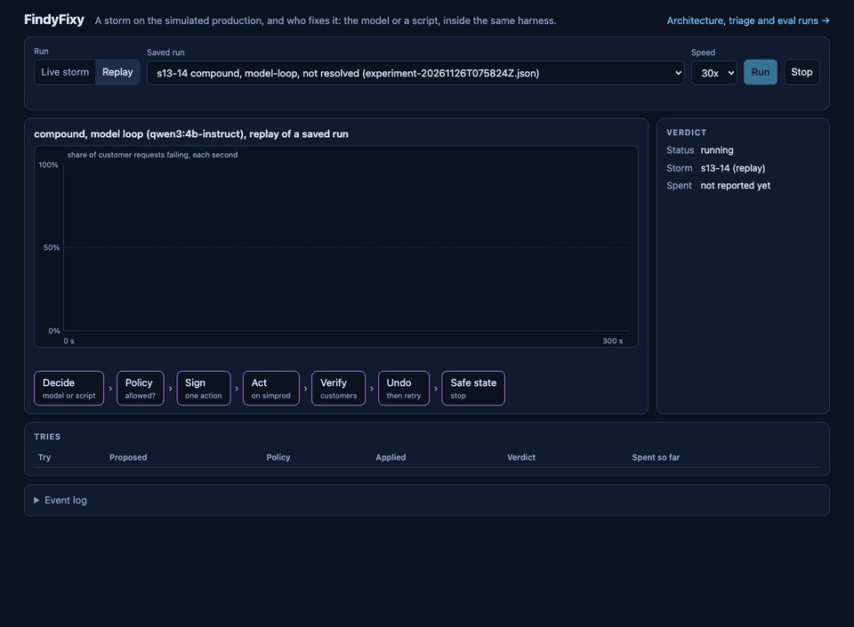
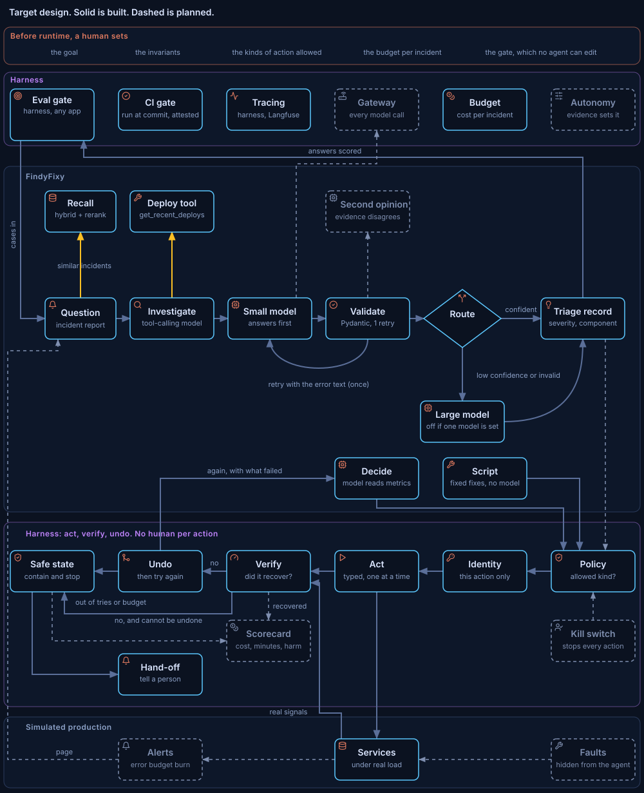

# Autonomous on-call, safe and affordable to be wrong

wyld3rness is being built as a harness and a set of agentic loops for agents that run on-call without a human approving each action. People will set the goal, the invariants, the allowed kinds of action and the budget before runtime. Code will decide what may act, check real signals, undo what did not work, and stop when the tries or the money run out. It is tested on FindyFixy, an event detection, determination and mitigation agent.

**Today FindyFixy diagnoses and proposes. It cannot act yet.** The loop and the simulated production it will act on are the build in progress.



## Built and planned

| The question | The control | Status |
|---|---|---|
| May this change ship? | Eval gate, and a CI gate that refuses an unattested change | **Built** |
| What happened, and what did it cost? | A trace per run, with a reference cost on each triage and eval model call | **Built** |
| What may one incident spend? | A budget reserved before each call, through one gateway | Planned |
| May this action run, and as whom? | Policy by kind of action, and a credential per action | Planned |
| Did it work? | A recovery check on real signals that the agent cannot touch | Planned |
| What if it was wrong? | Undo and retry where that is possible, otherwise a safe state. A kill switch above all of it | Planned |
| Is it worth it? | Agent against runbook, by cost per resolved incident | Planned |
| How much may it do alone? | A person approves each kind of action once, and evidence keeps or removes it | Planned |

## Cost is an invariant

Cost per resolved incident is every attempt's cost, failed ones included, divided by the incidents resolved. Today cost is measured and nothing limits it. The target: an incident cannot spend past its budget, the cheapest option that passes the safety and resolution bars wins, and a runbook with no model is always one of the options.

## Target design



Details: [design and strategy](code/docs/design.md), and the decision behind it, [ADR 0008](code/docs/adr/0008-autonomous-operation-with-cost-as-an-invariant.md).

## Run it

You need [uv](https://docs.astral.sh/uv/), Docker Compose with a runtime (Colima or Docker) and [Ollama](https://ollama.com/). Plan for 16 GB of memory and about 8.5 GB of model downloads.

```bash
cp code/examples/findyfixy/.env.example code/examples/findyfixy/.env    # model names; edit if you use other models
make setup                        # once per clone: packages, models, database, incidents
make up                           # start the database
make console                      # then open http://127.0.0.1:8765
make down                         # when you are done
```

`make setup` is safe to run again.

Then, in the page, pick Triage run or Eval run and press Run. Fake mode needs no model.

```bash
make triage           # triage five fixed questions in the terminal
make eval             # score FindyFixy on 30 golden cases through the harness (live models, minutes)
make case ID=g07      # one case end to end: the alert, the answer, every judge decision
make test             # the harness and FindyFixy tests (make test-harness: the harness alone)
make obs-secrets      # once: secrets for the local Langfuse stack
make obs-up           # then open http://127.0.0.1:3000 to see every run as a trace
make obs-prices       # once per stack: reference prices, so every model call carries a cost
make help             # everything else
```

## Docs

[Design and strategy](code/docs/design.md) · [Decision records](code/docs/adr/README.md) · [Changelog](code/CHANGELOG.md) · [Harness](code/src/wyld3rness/README.md) · [FindyFixy](code/examples/findyfixy/README.md) · [Workspace](code/README.md) · [Infrastructure](code/infra/README.md) · [Checks](tools/README.md) · [Hooks](.githooks/README.md) · [Contributing](CONTRIBUTING.md)

## Limits

One machine, local models, synthetic data, and a production that is simulated and will be labeled so wherever it is shown. Reference prices are a yardstick, not a bill. Nothing here is evidence of safety on real systems.

<details>
<summary>Disclaimer</summary>

This software and its documentation are provided "AS IS", without warranty of any kind, express or implied, including but not limited to warranties of merchantability, fitness for a particular purpose, accuracy and non-infringement. It is a research prototype and is not intended for production use or for decisions about real systems, incidents, safety or finances. Model outputs can be wrong, and the measurements here describe one setup on synthetic data.

To the maximum extent permitted by law, the author and contributors are not liable for any claim, damages or other liability, whether in contract, tort or otherwise, arising from or in connection with the software, its use or its documentation, including direct, indirect, incidental, special, consequential or other loss. You use it at your own risk and are responsible for reviewing, testing and securing anything you run. This section does not replace the warranty disclaimer and limitation of liability in sections 7 and 8 of `LICENSE`, which govern.

</details>

## License

Apache-2.0. See `LICENSE` and `NOTICE`. Contributions are licensed under the same terms; see `CONTRIBUTING.md`.

---

made with ❤️ in  Seattle by [wyld3rbit.ai](https://wyld3rbit.ai)
