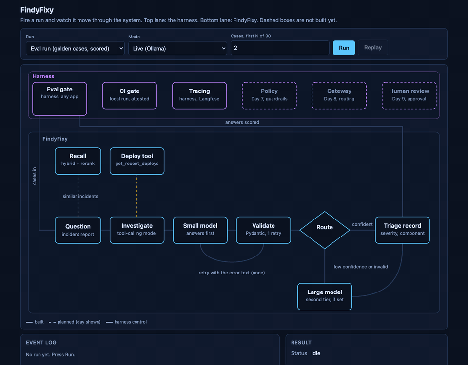

# wyld3rness

**A governance harness for autonomous on-call agents.** Your agent decides what is wrong and what to do. wyld3rness owns everything else: what the agent sees first, which changes it may make, whether customers recovered, when to undo, and what each incident cost. It runs on one machine with open-source models.



## Quickstart

You need [uv](https://docs.astral.sh/uv/), Docker Compose with a runtime (Colima or Docker) and [Ollama](https://ollama.com/). Plan for 16 GB of memory and about 8.5 GB of model downloads.

```bash
cp code/examples/findyfixy/.env.example code/examples/findyfixy/.env
make setup        # once: packages, models, database, incidents
make up           # start the services
make console      # open http://127.0.0.1:8765
```

`make help` lists everything else. `make down` stops the services.

## How it works

An incident runs as mostly ordinary code with two model steps, following [12-Factor Agents](https://github.com/humanlayer/12-factor-agents). The model never holds a key and never runs the loop.

| What happens in an incident | Who does it | Status |
|---|---|---|
| An alert starts the incident | code | planned |
| Gather what is needed first: metrics, past incidents, recent deploys | code | past-incident recall built; the rest planned |
| Find the cause | model, one small step | built as triage; judged on cause is planned |
| Choose a fix, as a typed action | model, one small step | planned |
| Check, sign and apply the fix | harness | planned |
| Watch customers, keep or undo | harness | planned |
| If it failed, tell the model why and try again | code | planned |
| Record every step, so a crash can resume | harness | traces built; the event log is planned |
| Out of tries: call a person | harness | planned |

Before any change to the agent ships, the eval gate scores it on golden cases, and CI refuses an answer-affecting change that no passing run covers. [Design](docs/design.md) has the picture and the invariants.

## Plug in your own agent

An agent implements one interface, `SystemUnderTest` in `code/src/wyld3rness/eval/sut.py`: `describe()`, `answer(case)` and the wiring its tests need. The harness never imports the agent, and a test fails if it does. [Harness guide](docs/harness.md).

FindyFixy, in `code/examples/findyfixy/`, is the example agent: it triages an incident alert with a small model first, recalls similar past incidents, and proposes a next action. simprod, in `code/examples/simprod/`, is a small simulated production it is tested against.

## Docs

[Design](docs/design.md) · [Harness](docs/harness.md) · [FindyFixy](docs/findyfixy.md) · [simprod](docs/simprod.md) · [Infrastructure](docs/infra.md) · [Decision records](docs/adr/README.md) · [Testing](docs/testing.md) · [Changelog](CHANGELOG.md) · [Contributing](CONTRIBUTING.md) · [For coding agents](AGENTS.md)

<details>
<summary>Disclaimer</summary>

This software and its documentation are provided "AS IS", without warranty of any kind, express or implied, including but not limited to warranties of merchantability, fitness for a particular purpose, accuracy and non-infringement. It is a research prototype and is not intended for production use or for decisions about real systems, incidents, safety or finances. Model outputs can be wrong, and the measurements here describe one setup on synthetic data.

To the maximum extent permitted by law, the author and contributors are not liable for any claim, damages or other liability, whether in contract, tort or otherwise, arising from or in connection with the software, its use or its documentation, including direct, indirect, incidental, special, consequential or other loss. You use it at your own risk and are responsible for reviewing, testing and securing anything you run. This section does not replace the warranty disclaimer and limitation of liability in sections 7 and 8 of `LICENSE`, which govern.

</details>

## License

Apache-2.0. See `LICENSE` and `NOTICE`. Contributions are licensed under the same terms; see `CONTRIBUTING.md`.

---

made with ❤️ in  Seattle by [wyld3rbit.ai](https://wyld3rbit.ai)
