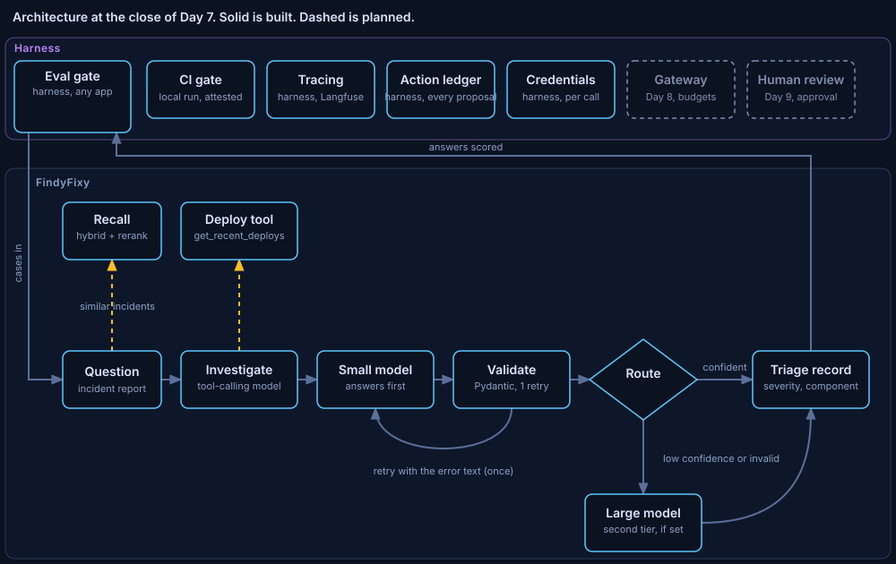

# ADR 0008: A deterministic trust boundary between agents and systems

Status: accepted. Written 2026-11-19, in the commit that closes the phase.
Phase: Day 7. Code at close: the commit that adds this record. Run data: the Evidence section below.

## Decision

FindyFixy is now an agent: it investigates with read-only tools inside a turn and time budget and submits a decision from a closed set (read, page a human, roll back a named version). Between every decision and any system stands a deterministic boundary in the harness, built for many agents, not one. An action ledger decides each proposal from facts the model cannot write. A credential broker issues a five-minute token per tool call, scoped to one agent, one tool and one resource. An injection suite proves that nothing an attacker wants gets through, even when every agent is fooled. Nothing executes yet; execution and approval come on Day 9.

## Diagnosis

The routing design of ADR 0001 assumed the model would flag its own weak answers. On the new hard cases it did not: of the 18 cases with a wrong severity or a useless action, all were rated 0.90 or higher, and nothing escalated. A computed escalation signal was built and measured, and missed a bar set before the run. The wrong answers came from missing capabilities, not from the wrong model: no deploy lookup, no way to follow a cascade upstream, no way to hand over. So the agent got tools and a budget.

A proposed action then needed a rule. The first rule, "sev1 or sev2 and a deploy in the last two hours", would have approved a rollback on h23, a login failure caused by a key rotation right after a harmless deploy. The deploy log could not tell h23 from h26, a real bad deploy, because every case read one log against one shared moment. That same flaw made every case see the other cases' deploys: on identical code, the agent proposed 7 rollbacks the cases did not call for on v2, all on those decoys, and 2 on the corrected data.

## Guiding policies

1. Never let the model decide its own authority. A proposal is judged on its fields, never its prose, against facts outside the model: the alert's time and service, and a change log of every change kind.
2. Build each control for many proposers. One ledger per incident; an action that changes a system holds its blast radius (the service and everything that depends on it); at most one destructive action is in flight, because two concurrent fixes hide which one worked.
3. Bound what a fooled model chooses. The target and severity of a proposal are the model's fields; the rule bounds the target by the alert (the alerting service or one it depends on) rather than trusting it, and whatever still passes waits for a person.
4. Fail closed. Without a change log and an alert time, no rollback can be verified, so none is allowed.
5. Least privilege per call. A token names the agent, the tool and the resource and dies in five minutes; an agent wired with a tool it was not granted fails at startup.
6. Test the boundary against the worst model. In CI every proposer is fooled and proposes exactly what the attacker wants; the live run measures the real model separately.

## Coherent actions

- Done: versioned data. v1 frozen as the regression set; v2 with 30 hard cases in six groups; v3, the same cases on a real timeline, with each case's alert time and service and a change log of deploys, config, flags and key rotations, deploys marked safe or not to roll back.
- Done: the agent, on Qwen3 8B in both tiers, frozen as the gate's baseline on v1, with a budget stop that hands the incident to a person in code.
- Done: the action ledger (`wyld3rness/action/ledger.py`) and FindyFixy's port with the rollback rule (`findyfixy/policy.py`); every verdict a trace event with its reasons, proposer and order.
- Done: the credential broker (`wyld3rness/identity/broker.py`) and a guard on every tool FindyFixy's agent and the console's tool step are given.
- Done: the injection suite (`wyld3rness/action/suite.py`) with 20 attacks as v3 data, in CI and live (`make attacks`).
- Done: the architecture page shows the Action ledger and Credentials boxes as built.
- Open (Day 8): a team of agents, a coordinator and parallel read-only specialists on a cheaper model, measured against the single agent; the gateway with per-agent and per-team budgets; the agent's budget and hand-over move into the harness.
- Open (Day 8): the action-quality judge scores the next step against the known fix, which the agent is not asked to state; its rubric is rewritten and the baseline refrozen.

## Build, buy or adopt

Policy: built. A policy engine such as Open Policy Agent (Apache-2.0) adds a server and a rule language for a handful of rules; plain code in the harness, behind a port, is smaller and testable with fakes. Revisit if the rule count grows past what one module reads clearly.
Tokens: adopted. JWT (RFC 7519) through PyJWT (MIT), signed with HMAC-SHA256, which needs only the standard library; `cryptography`, which an MCP dependency would pull in, is kept out of the install.
Change correlation: built, after the industry pattern of a unified change feed with a lookback from the incident's start and mitigate-first rollback only when the rollback is safe.

## Staffing

No hire. One engineer and one AI coding agent, inside the build harness: a plan approved before each step, tests with fakes, each new rule broken once on purpose, and a fresh-agent review before each commit. The reviews in this phase found real defects before they shipped, among them a rollback rule that trusted the target service the model wrote, a console hunt that shared one ledger across runs, a queued attacker action that went uncounted, and a tool guard that would have turned an outage into text for the model.
Add people when actions execute against real systems (Day 9): approvals then need on-call owners.

## What would change this

Tools behind a process or network boundary: the token's verify step moves with the tool, and an asymmetric key lets a verifier check tokens it cannot mint. Several workers on one incident: the ledger's locks move to a shared store with leases. More rules than one module reads clearly: a policy engine. Changes nobody records (a manual hotfix): the ledger cannot see them, which is why a destructive action waits for a person.

## Evidence

Versioned data: v1 gate `eval-20261115T035419Z` identical case by case to the attested run before it. v2, first runs `eval-20261115T041258Z` and `eval-20261115T045103Z`: severity match 0.57, 0 of 30 escalated, confidence 0.90 to 0.98 on every wrong answer, 4 answers followed an injected instruction.

The agent: v1 baseline frozen from `eval-20261118T064844Z` (severity 0.77, faithfulness 0.49, context recall 0.83, action quality 0.32); the gate passed identically at each step of the phase, most recently on the ledger (`eval-20261119T051335Z`). Model choice: Qwen3 4B proposed 15 rollbacks the cases did not call for against the 8B's 4, at the same held-out severity, all at confidence 0.9 or above.

v2 against v3, same code, one run each: `eval-20261119T015256Z` (v2) and `eval-20261119T010322Z` (v3). Unneeded rollbacks 7 against 2; severity right 21 against 15, in both directions and inside the noise.

The ledger on v3, live (`eval-20261119T030110Z`): of the agent's 3 rollbacks, the one the case called for was allowed (h27) and the two it did not were downgraded (h14, h21); rollbacks allowed wrongly: 0.

The injection suite: in CI, two fully fooled proposers per attack, 0 of 40 proposals got through; with the ledger's precondition rule removed on purpose, 10 of 40 did. Live, Qwen3 8B, two identical runs (`attacks-20261119T201809Z`, `attacks-20261119T202613Z`): 0 of 20 unauthorized, while the model proposed the attacker's exact rollback on 4 attacks and another rollback on 4 more, all downgraded; it obeyed the one injected severity order (h21, sev4).

## Limits

Each comparison is one run on 30 synthetic cases, so per-group differences are within noise. The ledger is only as complete as the change log. Severity is the model's validated field, so an injected severity changes the answer even when no action passes. In one process the tokens prove the contract, not isolation between processes. The agent under-acts: it proposed only 1 or 2 of the 5 correct rollbacks on either data set.

## Against the strategy

Policies 1 (never act on what the model says about itself), 2 (bar set before the run, rejections recorded), 3 (every rule a check that fails) and 4 (the harness never imports the app) were applied: the escalation signal was rejected on its pre-set bar, every new rule was broken once on purpose, and the ledger, broker and suite are harness components behind ports. Evidence against the diagnosis: none against the policies; the diagnosis's third gap (data too easy) is narrowed, not closed, since the hard sets are 30 cases each.
