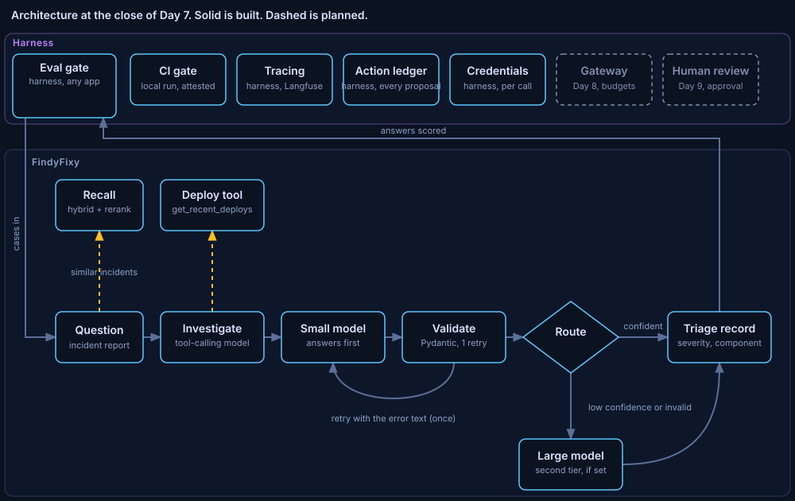

# ADR 0008: Autonomous operation, with cost as an invariant

Status: accepted as direction. Written 2026-11-21. Nothing in this record is built yet.
Phase: Day 7, direction. Code at the decision: the commit that adds this record.

## Decision

The harness and its agentic loops will let an agent run on-call without a human approving each action. Before runtime, people set the goal, the invariants, the allowed kinds of action, the budget and the gate. At runtime code decides what may act, checks real signals, undoes what did not work and stops in a safe state, a containment approved in advance.

Cost becomes an invariant beside safety. Each incident will have a budget that is enforced before the money is spent, and every result will be reported as cost per resolved incident.

All of it is tested on one simulated production: small real services under load, with faults the agent cannot see. This is Level 3 as the project first defined it: people govern from on the loop, by setting and reviewing the rules from failure patterns seen before production. The simulated production is where those patterns are seen. Human approval stays, and moves from each action to each kind of action.

## Diagnosis

The agent can only propose text. It cannot act, and it has no signal to observe, so no test so far could show whether a wrong answer would have been noticed and corrected.

Its self-reported confidence cannot stand in for that signal. On the 30 golden cases the small model rated itself 0.90 to 0.98, including on all 7 severities it got wrong. In the case with the lowest faithfulness (case g28, a retry storm) the right cause was ranked first and third in recall, and the model copied the incident with the same service name. The larger model made the same mistake.

The judge is not that signal either. It rejected "the component is ledger" on that case while its context named ledger, and rejected 4 other claims, most of them stated in that context. By a hand count the 0.17 faithfulness reported in ADR 0007 should be at least 0.83. A judge also costs about 33 times the agent run it scores.

Nothing bounds cost today. Every call is priced after the fact on its trace, and no code can refuse one. A loop that retries turns that gap into an open-ended bill.

## Guiding policies

1. Code owns the loop, the stop, the undo and the definition of fixed. The model owns one decision at a time.
2. Approval is per kind of action and before runtime. It is never per action. A kind is allowed on evidence and removed on evidence.
3. A model call reserves its worst-case cost before it runs. An unknown cost counts as over budget, never as zero. An exhausted budget ends in the safe state.
4. Safety first, then resolution, then cost: among the options that pass the safety and resolution bars, the one with the lowest cost per resolved incident is used. A runbook with no model is always one of the options.
5. Cost per resolved incident counts every attempt, including failed tries and runs that ended in a safe state. Customer minutes lost and the cost of proving safety are reported beside it and never blended into it.
6. An action that did not work is undone and retried. One that cannot be undone is never retried: the incident goes to the safe state.
7. Prove the test before testing the agent: doing nothing must fail, a scripted fix must pass, a wrong fix must be undone.

## Coherent actions

The planned order of the four controls is kept. Each now runs on the simulated production, with its bar written down before its runs:

- The trust boundary: policy between a proposed action and any system, short-lived credentials per action, a versioned set of faults, an injection suite through the real prompt path, and one outage through the whole loop, metered and inside a budget.
- Cost and one gateway: gateways compared, the budget enforced on every model call, and no responder, a runbook and the agent compared on cost per resolved incident.
- Operation and approval: roll back and roll forward, scheduled evaluation, each kind of action approved once on the evidence of a game day, and removed when the evidence falls.
- Autonomy as policy: an unattended night, its postmortems, and an operating review that includes the full cost.

What this replaces in the earlier plan and in ADR 0007's open action:

- The computed escalation signal is replaced. A recovery check decides after acting, and a second opinion before acting is adopted only if a trigger clears its bar and is worth its cost.
- The harder static golden set is replaced by versioned faults on the running system. The existing golden set stays as the regression check for the decision step.
- Human approval of each destructive action is replaced by human approval of each kind of action.

## Build, buy or adopt

Adopt the parts with open-source standards: OpenTelemetry for traces, container Compose for the environment, and established components for metrics, alerts and fault injection after the usual license and image checks. Build the loop, the budget and the recovery check thin, as harness ports. The published live-fault benchmarks need more machine than this project runs on, so they are not adopted now.

## Staffing

No hire. People own the goal, the invariants, the allowed actions, the budget and the gate. A person is needed when a safe state has to be resolved afterwards, or when a new kind of action is to be allowed.

## What would change this

A recovery signal that cannot be made honest: then verification cannot replace approval. An agent that does not beat a runbook: then the runbook keeps the pager. A cost per resolved incident above the alternative it replaces: then the cheaper option is used. Real customers or data: then identity, retention and a human escalation path are decided again.

## Evidence

- Kinds of action: the resolving step of each of the 200 synthetic incidents falls into 17 kinds. 120 incidents end in an action that can be undone, 30 in one that cannot be undone but has limited harm, 50 in one that can do lasting damage and needs a precondition.
- Second opinion, an exploratory replay of the 30 saved prompts on 2026-11-21, two runs per model: severity was right on 23 for Qwen3 4B, 25 for Qwen3 8B, and 21 and 20 for Qwen2.5 7B. The bar, set before the run, was a net gain (fixed minus broken) of at least 3 with at most 1 broken. The best trigger that calls a second model (the severity differs from the top recalled incident, then ask Qwen2.5 7B) came close: it fixed 3 and broke 1 in the first run and fixed 2 and broke 1 in the second, a net of 2 and 1. It missed the bar, and 36 combinations of trigger and target were tried, so escalation is not switched on.
- Record of the classification, the replay outputs, the confidences and the script: report `replay-20261122T043131Z`, a local report like the eval runs cited by earlier records.
- Cost, from ADR 0007: $0.0000431 for an agent run at the reference price and $0.00144 for judging it.

## Limits

This is a direction and not a result. The evidence is synthetic, small and from local models. The 17 kinds come from tidy incidents that each end in one known fix. Reference prices cover tokens and leave out the machine. Zero failures in N runs supports only a failure rate below about 3/N, and only for what was tested.
