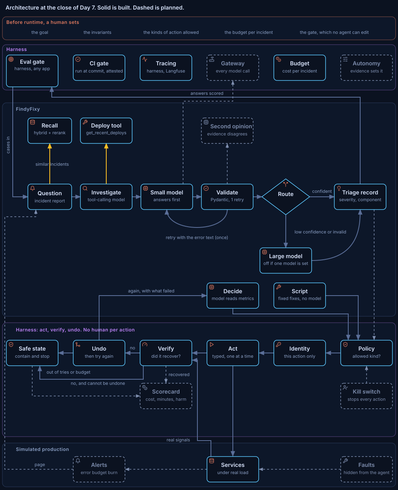

# ADR 0009: Day 8

Status: open. Begun 2026-11-26 with step 0; the day's direction is added when Day 8 is planned.
Phase: Day 8. Code at the decision: the commit that adds this record.

## Day 8 decisions

### Step 0: the safe state hands the incident to a person (written in the plan, before the code)

**Why.** The safe state undoes every change and stops, and until now told nobody. A person learned of it only by looking. The incidents the agent could not fix are exactly the ones a person must see.

**Decision: a hand-off port in the harness, sent as an Alertmanager webhook.** When `run_incident` ends in the safe state, the harness builds one alert from the incident's record (what was tried, what was undone, why it stopped, the trace) and the app's hand-off sends it. FindyFixy's sends it over HTTP to the on-call URL; in this setup that is the console's on-call inbox. Whether it was delivered goes into the incident's record and its events. A hand-off that cannot be delivered never changes the outcome: the incident stays in the safe state, and the record says "not delivered".

**Blueprint searched.** Prometheus Alertmanager's webhook payload (Apache 2.0): the format on-call tools already take from monitoring, so a real pager can replace the console without a change to the harness. Adopted as the message format; nothing is installed.

**Options.**

| Option | For | Against |
|---|---|---|
| Webhook to the console's inbox (recommended) | notifies something today; any pager that takes the format can replace it | the console must be running to receive |
| A local pager in a container (ntfy) | a phone notification | one more service to scan and run |
| Write the hand-off into the record only | smallest | nobody is told, the gap stays |
| Do nothing | | safe-state incidents stay silent |

**What would change this.** A real on-call tool: then its URL replaces the console's, and the format stays. Hand-offs that must be acknowledged: then the inbox gains an acknowledgement, and an unacknowledged one is sent again.
