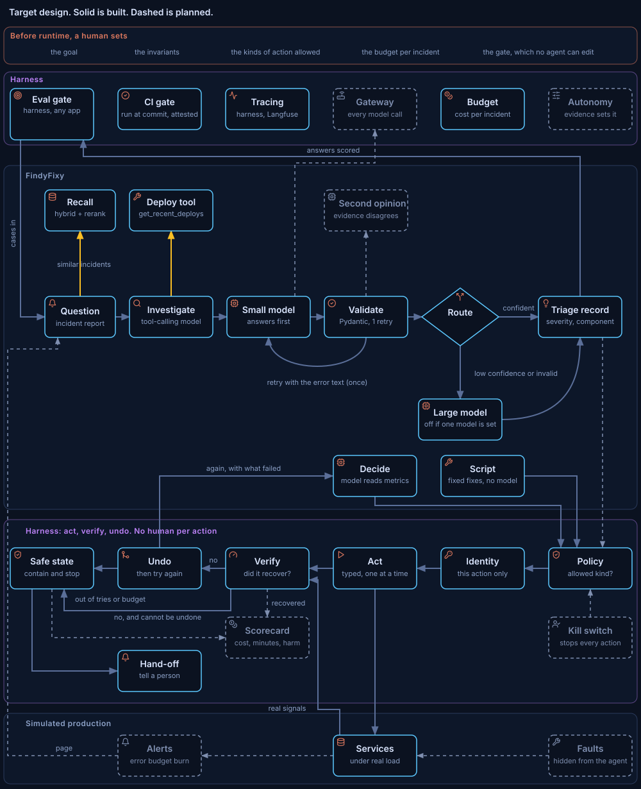

# Design and strategy

**wyld3rness is being built as a harness and a set of agentic loops for running on-call without a human approving each action, inside a cost budget.** It is tested on FindyFixy, the agent in this repository. Today FindyFixy diagnoses and proposes: the loop that acts is planned. This page is the whole picture. The [decision records](adr/README.md) record what each phase decided and measured.



## The question

An agent is a non-deterministic component inside a system that must behave deterministically where it matters. It will sometimes be wrong with full confidence, and the text it reads can be hostile. The question is how it can operate with nobody approving each action, at a cost worth paying.

The answer this design gives: **make it safe and affordable to be wrong.** A wrong action is limited before it runs, detected on real signals afterwards, undone, and paid for from a budget that cannot be exceeded.

## Who decides what

This is the target.

| Who | Decides | When |
|---|---|---|
| People | The goal, the invariants, the allowed kinds of action, the budget, the gate | Before runtime |
| Harness, in code | Whether an action may run, as whom, at what cost, whether it worked, undo, stop | Every step |
| Agent, a model | The likely cause and one typed action | Once per try |
| The system | Whether customers recovered | After every action |

An agent will be able to edit none of the first two rows. A kill switch will exist, and no action will wait for someone to use it.

## One incident, end to end

This is the target. The invariants table below says which parts are built.

1. A service burns its error budget and the alert pages the agent.
2. The harness opens the incident's budget. Each model call reserves its worst-case cost first.
3. The agent reads signals, changes and past incidents as untrusted data, and proposes one typed action.
4. Policy checks the kind of action and its preconditions at the moment it executes. Identity issues a credential for that action only. One writer acts on a blast radius at a time.
5. After a wait, a check the agent cannot touch reads the real signals.
6. Recovered: the action is kept. Not recovered and it can be undone: it is undone, and the agent tries again with fresh context and what failed. Not recovered and it cannot be undone: there is no retry, and step 7 follows.
7. Out of tries or budget, or after a failure that cannot be undone, the system goes to a safe state: a containment approved in advance, after which nothing else changes.
8. The trace and the scorecard record every step, its cost and the outcome.

## Cost

Today cost is measured on traces and nothing limits it. This is the target.

```
                                model calls + tool calls + responder compute, over EVERY attempt
cost per resolved incident  =   ----------------------------------------------------------------
                                                   incidents resolved
```

Failed tries and safe states stay in the numerator, so an agent cannot look cheap by failing fast. Three rules apply:

- **Bound it.** A call that could exceed the incident's budget does not run. An unknown cost counts as over budget.
- **Compare it.** A runbook with no model is always in the comparison. A model, a second opinion or a retry stays only if what it adds is worth what it costs.
- **Show all of it.** Customer minutes lost and the cost of assurance (evaluations, game days) are reported beside the responder's cost, never blended into it.

Local models are priced at a committed reference price per token. It is a yardstick, not a bill.

## The release path

No change that can alter an answer reaches main without a measured, attested run.

```
 git commit with an answer-affecting file staged
      ▼
 export      exactly the staged tree, not the working copy, with its own environment
      ▼
 eval run    the app answers the golden cases; a judge model scores each answer whose
             judge inputs changed, the rest keep the attested run's score
      ▼
 gate        fails on a measured regression against the frozen baseline → no commit
      ▼
 attestation the passing run's fingerprint of every answer-affecting file, added to the commit
      ▼
 push        every pushed commit's attestation is checked: merges and rebases skip pre-commit
      ▼
 CI          recomputes the fingerprint; no passing run covers the change → refused
```

Why at commit, not at push or in CI. A check at push finds a commit that made answers worse only after more work is built on it, and a CPU-only CI runner would take hours. The gate runs before the commit exists, on what the commit will hold, so a regression is never committed. The cost is time at commit: the answer pass on every gated commit, and judging only for the cases whose answer, contexts or proposed action changed. A change to the judge, its prompts, the embedder or the lock changes every case's judge key, which forces a full run. A reused score names the run that judged it, and `--no-reuse` judges every case, which is how a phase closes. A remote judge or a GPU runner would let CI run the gate itself, and the commit hook would become advisory.

## How an app plugs in

The harness never imports the app. Each control is a port the app implements or calls:

- `SystemUnderTest` (built): describe, answer, summarise. The eval gate runs the app through it.
- The event adapter (built): the app reports its steps, and the harness turns them into spans.
- The environment port (planned): the app supplies observe, its typed actions, and for each either an undo or the declaration that it has none. The harness owns the loop, the recovery check and the stop.
- The action port (planned): the app declares each kind of action, its blast radius and the preconditions policy checks.
- The model port (planned): the app asks the gateway for a completion. The gateway routes, meters and refuses, and the app holds no model client.

Dependencies point inward: the harness defines the ports, the app depends on them, and one composition root in the app wires the real implementations.

## Diagnosis

The harness wraps a model whose output varies from run to run and whose statements about itself have not held up. The evidence is consistent across three phases, and it is what the strategy rests on.

The routing design assumed the small model would flag its own weak answers, so the large model would take the hard cases. In the first five runs the model's confidence did not even keep one scale: two answers used 0 to 1 and three used 0 to 100. The highest rating went to one of the worst answers (ADR 0001). Validation fixed the scale but not the judgement. A tool call passed every check in all of its runs and gave the right answer in none of them, because validation catches shape and not meaning (ADR 0002). By the last measured runs the escalation rate was 0%. The weakest case scored a faithfulness of 0.17, about a fifth of the run's average of 0.79, and still reported a confidence above the threshold (ADR 0007). A routing rule that never fires is not a control, and the cost and quality case for the two-model design is still unproven.

Three controls work today: the eval gate, the CI gate that refuses an unmeasured answer-affecting change, and a trace for every run (ADRs 0005 to 0007). What they share is that each choice was made against a number set in advance, including the choices to say no. An evaluation library was turned down although it would have saved writing the metrics, because it brought 31 new packages and a vulnerability with no fix (ADR 0005). Batching the judge's verdicts would have cut about a third of the judge's calls per case, derived from the per-case counts in ADR 0006. It was rejected, because its agreement came in 6 points under a 0.9 bar set before the run. The cheaper path was available both times, and the measurement said no. Where the measurement said yes, the gain was taken: running every answer before any judging cut the gate's wall time by 22% with no score changed (ADR 0007).

Five gaps remain. First, the agent only proposes: its next action is free text, and no step in the graph acts on it. Second, there is nothing to act on and no signal to check, so being wrong has never been observed or corrected. Third, nothing bounds cost: calls are priced after the fact, model clients are created in 7 modules, 2 in the harness and 5 in the app, and no single place could refuse a call. Fourth, quality is measured on 30 static synthetic cases with a judge that is itself sometimes wrong (ADR 0008). Fifth, every control trusts one developer: the attestation is a process control, and the model names come from an untracked `.env` file (ADR 0006).

## Guiding policies

Each policy names its trade-off and the decision records it comes from.

1. **Never act on what the model says about itself.** Validate every output against a contract, and compute action, retry and stop decisions from facts the model cannot write. Trade-off: a second signal costs compute and design time, and early answers route more slowly. From ADRs 0001, 0002 and 0007.
2. **Set the bar before the run, and record a rejection as a result.** A change is adopted on a labelled measurement, with its bar written down first; one run is an anecdote, and the spread is reported. Trade-off: every decision waits for a labelled set and a measured run. From ADRs 0004 to 0007.
3. **Turn every rule into a check that fails.** A rule that matters gets a test, a hook or a CI job that breaks when it is broken, and that check is proven to fail once. Trade-off: each check is code to maintain, and a process check still trusts whoever runs it. From ADRs 0006 and 0007.
4. **The harness never depends on the app.** Each control is a port the app implements or calls, so a second app needs an adapter and no change to the harness. Trade-off: every control needs an interface and an adapter, which is more code than wiring it into one app. From ADRs 0006 and 0007.
5. **Open source, local and pinned, with an established blueprint first.** Every dependency carries an OSI license, a pinned version or digest and an audit; custom code covers only what the blueprint lacks. Trade-off: smaller local models, no GPU in CI, and slower adoption of new releases. From ADRs 0003, 0005, 0006 and 0007.
6. **Unknown is not zero.** A failed judge call is excluded and counted, a missing token count is left out, and a negative control can never become a baseline. Trade-off: reports carry gaps and counts that a single number would hide. From ADRs 0005 and 0007.
7. **Cost is an invariant.** Every incident is to have a budget, reserved before each model call (planned). Among the options that pass the safety and resolution bars, the lowest cost per resolved incident wins. Trade-off: some incidents a richer budget would resolve end in a safe state instead. From ADR 0008.
8. **Code owns the loop.** The model makes one decision. Code decides whether it may act, whether it worked and when to stop. Trade-off: the agent cannot improvise an action nobody allowed. From ADR 0008.

Each policy is held to three tests. It is applicable, because it decides a real trade-off in the records above. It is enforced, by the checks below as they are built. And its effect compounds, because the same rule carries into every later control.

## Invariants

A control counts as built only when a check fails if someone goes around it.

| Invariant | Policy | Check that enforces it | Status |
|---|---|---|---|
| No change that can alter an answer ships without a passing, attested eval | 2, 3 | The pre-commit hook gates the staged tree and refuses a failing commit; pre-push checks every pushed commit; CI rehashes every answer-affecting file and fails a change no passing run covered | built |
| Every request, model call, tool call and decision is a trace, with its eval scores attached | 3, 6 | Tests read the spans a run emits; a run with the backend down keeps its speed | built |
| The harness never imports the app | 4 | A test fails if the harness imports anything but the standard library, its declared dependencies and itself | built |
| No incident spends past its budget | 6, 7 | A call whose worst case does not fit is refused, including when its cost is unknown | planned |
| No model call bypasses the gateway, which meters, routes and pins | 3, 7 | An architecture test fails if any module other than the gateway imports a model client | planned |
| No action runs unless its kind was allowed before runtime and its preconditions hold when it executes | 1, 8 | A fully fooled proposer, forged telemetry and stale plans cause 0 unauthorized actions | planned |
| Retrieved, telemetry and user text is data, never instructions | 1 | An injection suite of attack prompts, poisoned incidents and forged telemetry, through the real prompt path, with 0 unauthorized actions, in CI | planned |
| Quality is measured in operation, not only before release | 2 | A scheduled run below the gate raises an alert and lowers autonomy | planned |
| No credential outlives one action or reaches beyond one resource | 1, 3 | A token used on the wrong action or resource, or after expiry, is refused | planned |
| Nothing is called fixed until real signals recover and hold | 1, 8 | Doing nothing fails, a scripted fix passes, a wrong fix is undone | planned |
| Every incident ends resolved or in a safe state, with no human per action | 8 | Spent tries, a spent budget, an error and the kill switch each end in the safe state | planned |
| One writer per blast radius | 3, 8 | Colliding incidents never change one resource at the same time | planned |
| Autonomy of each kind of action is a function of evidence, in code | 1, 2 | Worse evidence removes the kind, and no setting grants one past its evidence | planned |

## Exceptions

A policy can be challenged, and the challenge has one path. An exception needs the project owner's approval and an entry in the decision log that names the policy, the reason and what was rejected. The release cooldown of policy 5 has been overridden this way. Postgres 17.11 was taken for the tracing stack 3 days into its cooldown, as a named exception recorded on 2026-11-09. An exception that recurs is a signal to change the policy, not to keep granting it.

## Autonomy as policy

Level 1: the agent advises and people act. Level 2: the agent acts after a person approves each action. **Level 3, the target: the agent acts, rolls back, rolls forward and writes the postmortem under the same risk controls, and people govern from on the loop: they set and review the rules, from failure patterns seen before production.** On the loop means nobody has to approve or watch each action. A person approves each kind of action once. Today every kind of action is at Level 1, because nothing can act.

Autonomy will be granted per kind of action:

| Kind | Examples | What Level 3 requires |
|---|---|---|
| Can be undone | roll back a release, revert config, add capacity, fail over | a tested undo and a recovery check |
| Cannot be undone, limited harm | flush a cache, cancel a migration | a scope and rate limit, and a recovery check |
| Can do lasting damage | delete logs, issue a credential, restore an old certificate | a precondition code can prove, checked at execution, or the safe state |

A kind reaches Level 3 only on evidence from the simulated production that passes thresholds written down before the runs: no lasting harm over enough varied attempts, resolution no worse than the runbook, and a cost per resolved incident inside its bar. Falling evidence removes it automatically. Zero failures in N attempts supports only "below about 3/N", so the claim is never stronger than that.

## What changes next

The order of the four controls is kept, and each will run on a simulated production. The computed escalation signal and the harder static golden set of the earlier plan are replaced by the recovery check and by versioned faults (ADR 0008). Each is recorded in the decision record of the phase that builds it:

1. **The trust boundary.** Policy before any action, a credential per action, versioned faults that close the gap left by static cases, an injection suite, and one outage through the whole loop inside a budget.
2. **Cost and one gateway.** Gateways compared, every call metered and bounded, and the agent against a runbook on cost per resolved incident.
3. **Operation and approval.** Roll back and roll forward, scheduled evaluation, and approval of each kind of action on the evidence of a game day.
4. **Autonomy as policy.** An unattended night, its postmortems, and the operating review with its full cost.

Trust in one developer stays open by design while there is one developer. It closes when a second developer or an outsider must trust a merge, and a real run on a GPU runner replaces the attestation (ADR 0006).

## The repository

```
code/
├── src/wyld3rness/          the harness: never imports an app
│   ├── eval/                runner, judge metrics, gate, attestation, gate at commit, score reuse
│   └── trace/               events to spans, scores, cost
├── examples/findyfixy/      the agent under test
│   └── src/findyfixy/
│       ├── triage/          the agent graph
│       ├── tools/           the agent's tools
│       ├── retrieval/       incident memory: vector, keyword, reranker
│       ├── evals/           golden set and the adapter the harness drives
│       ├── console/         the live visualizer
│       └── wiring.py        the one composition root
├── infra/                   self-hosted services
└── docs/                    this page and one decision record per phase
tools/                       public checks: docs drift, privacy scan, pictures
```

## The stack

| Concern | Choice | License |
|---|---|---|
| Models | Qwen3 4B answers, Qwen2.5 7B judges, served by Ollama | Apache 2.0, Ollama MIT |
| Agent loop | LangGraph, LangChain core | MIT |
| Validated output | Pydantic | MIT |
| Incident memory | Postgres with pgvector | PostgreSQL |
| Embedding, reranking | bge-small-en-v1.5, bge-reranker-base | MIT |
| Tracing | OpenTelemetry into self-hosted Langfuse | Apache 2.0, MIT |

## Two harnesses

This design is the runtime harness: what ships around the agent. The build harness is how the coding agent is constrained while it writes the code: written rules, hooks, the privacy scan, a plan before code, and a fresh-agent review before each substantial commit.

## What this design does not cover

It is one machine, one engineer, synthetic data and a simulated production. It does not show behavior under real customers, real gaps in telemetry or organizational scale, or safety for faults and actions that were never tested. Multi-tenant isolation, high availability, retention and a real identity provider are not built. Learning from resolved incidents waits until the loop is proven.

## Review

Each phase's decision record reports whether this strategy held: which policy it applied, and any evidence against a policy or the diagnosis. If several policies fail their tests, the diagnosis is re-examined first.
