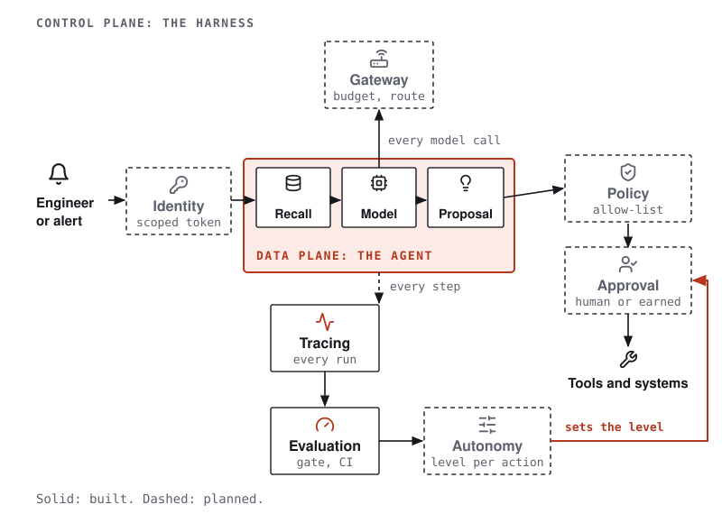

# Design and strategy

This document is the target design of wyld3rness and the strategy that moves the code toward it. It runs from the idea and the shape, through the policies and the invariants that enforce them, to the evidence so far, what comes next and the limits. The decision records in `docs/adr/` record what each phase decided and built.

## The idea

An LLM agent is a non-deterministic component inside a system that must behave deterministically where it matters. The same alert can produce a different answer on a different day, a retrieved document can carry instructions, and a confident answer can be wrong. The question the harness answers is how much an agent may do on its own, and on what evidence.

The answer this design gives: the agent never decides its own authority. Every request crosses a fixed set of checkpoints, each checkpoint enforces one invariant in code, and the authority each kind of action runs with is set by measured evidence, also in code.

The shape follows 12-Factor Agents: an incident runs as ordinary code with two model steps, finding the cause and choosing the fix, and code the harness owns does everything else, from gathering context before the model is called to undoing a change that did not help. The incident flow table in the root README marks which of those steps are built.

## The harness

The **data plane** is the app. FindyFixy, the example app, takes an incident alert, recalls similar past incidents, calls models and tools, and proposes a triage record with a next action. The data plane is where the model's judgement is used.

The **control plane** is the harness. It sits on every path in and out of the data plane: requests, model calls, tool calls, proposed actions, releases. It never relies on the model behaving. Each of its checkpoints is deterministic code that holds the same way for every request.

### One request, end to end

An engineer pastes an alert. The request carries the engineer's identity, which the broker uses for every later token. Recall reads past incidents from memory and marks them as untrusted data in the prompt. The model call goes through the gateway, which checks the budget, picks the model, and records tokens and cost.

The model proposes a triage record and an action. Schema validation rejects a malformed record, and the router escalates to the larger model when a computed signal, not the model's own confidence, says the answer is weak. Policy then checks the proposed action against facts the model cannot forge: the action is on the allow-list, the severity comes from the validated record, the deploy it wants to roll back exists in the deploy log.

If the action is allowed, its class decides what happens next. A read action runs. A destructive action runs at the level the autonomy policy grants its class: it waits for a human at Level 2, and runs with a human on the loop only at Level 3. Every tool call presents a token the broker issued for that one tool, resource and minute. Every step lands in the trace, and eval scores attach to the same trace.

### How an app plugs in

The harness never imports the app. Each control is a port the app implements or calls:

- `SystemUnderTest` (built): describe, answer, summarise. The eval gate runs the app through it.
- The event adapter (built): the app reports its steps, and the harness turns them into spans.
- The action port (planned): the app declares its actions, their classes and the facts policy checks.
- The model port (planned): the app asks the gateway for a completion and never holds a model client.
- The approval port (planned): the harness pauses a run and resumes it on an approval record.

Dependencies point inward: the harness defines the ports, the app depends on them, and one composition root in the app wires the real implementations.

### Two harnesses

This design is the runtime harness: what ships around the app. The build harness is how the coding agent is constrained while it writes the code: written rules for the agent, the pre-commit hooks, the privacy scan, plan-before-code, and a fresh-agent review before each substantial commit. Both are named in every write-up, because the word harness means the second one to many readers.

## Guiding policies

Each policy names its trade-off and the decision records it comes from.

1. **Never act on what the model says about itself.** Validate every output against a contract, and compute escalation and action decisions from facts the model cannot write. Trade-off: a second signal costs compute and design time, and early answers route more slowly. From ADRs 0001, 0002 and 0007.
2. **Set the bar before the run, and record a rejection as a result.** A change is adopted on a labelled measurement, with its bar written down first; one run is an anecdote, and the spread is reported. Trade-off: every decision waits for a labelled set and a measured run. From ADRs 0004 to 0007.
3. **Turn every rule into a check that fails.** A rule that matters gets a test, a hook or a CI job that breaks when it is broken, and that check is proven to fail once. Trade-off: each check is code to maintain, and a process check still trusts whoever runs it. From ADRs 0006 and 0007.
4. **The harness never depends on the app.** Each control is a port the app implements or calls, so a second app needs an adapter and no change to the harness. Trade-off: every control needs an interface and an adapter, which is more code than wiring it into one app. From ADRs 0006 and 0007.
5. **Open source, local and pinned, with an established blueprint first.** Every dependency carries an OSI license, a pinned version or digest and an audit; custom code covers only what the blueprint lacks. Trade-off: smaller local models, no GPU in CI, and slower adoption of new releases. From ADRs 0003, 0005, 0006 and 0007.
6. **Unknown is not zero.** A failed judge call is excluded and counted, a missing token count is left out, and a negative control can never become a baseline. Trade-off: reports carry gaps and counts that a single number would hide. From ADRs 0005 and 0007.

Each policy is held to three tests. It is applicable, because it has already decided a real trade-off in the decision records. It is enforced, by the checks under Invariants. And its effect compounds, because the same rule carries into every later control.

### How a policy is challenged

A policy can be challenged, and the challenge has one path. An exception needs the project owner's approval and an entry in the decision log that names the policy, the reason and what was rejected. The release cooldown of policy 5 has been overridden this way. Postgres 17.11 was taken for the tracing stack 3 days into its cooldown, as a named exception recorded on 2026-11-09. An exception that recurs is a signal to change the policy, not to keep granting it.

## Invariants

These are the invariants the harness holds for every request. A control counts as built only when a check fails if someone goes around it.

| Invariant | Policy | Check that enforces it | Status |
|---|---|---|---|
| No change that can alter an answer ships without a passing, attested eval | 2, 3 | CI rehashes every answer-affecting file and fails a change no passing run covered | built |
| Every request, model call, tool call and decision is a trace, with its eval scores attached | 3, 6 | Tests read the spans a run emits; a run with the backend down keeps its speed | built |
| The harness never imports the app | 4 | A test fails if the harness imports anything but the standard library, its declared dependencies and itself | built |
| Retrieved and user text is data, never instructions: no model output acts until deterministic policy approves it | 1 | An injection suite of attack prompts and poisoned incidents, with 0 unauthorized actions, in CI | planned |
| No credential outlives one call or reaches beyond one tool and resource | 1, 3 | A token used on the wrong tool, resource or after expiry is refused | planned |
| No model call bypasses the gateway, which enforces budget, routing and the model pins | 3, 5 | An architecture test fails if any module other than the gateway imports a model client | planned |
| No destructive action runs without a human, unless autonomy for that class was earned on evidence | 1, 2 | A destructive action pauses until an approval record exists | planned |
| Quality is measured in operation, not only before release | 2 | A scheduled run below the gate raises an alert, and once autonomy exists, lowers it | planned |
| The authority of each action class is a function of evidence, in code | 1, 2 | Changing the evidence changes the level; no setting raises a level by hand | planned |

## Autonomy as policy

The levels come from the series thesis. At Level 1 the agent advises and humans act. At Level 2 the agent acts after a human approves. At Level 3 the agent acts, and humans govern from on the loop, with the power to undo.

Autonomy is set per action class, not per agent:

| Class | Examples | Starts at |
|---|---|---|
| Read | recall, read logs, read metrics, list deploys | Level 3: runs freely |
| Reversible | page a human, open a ticket | Level 3: acts, human on the loop |
| Destructive | roll back a deploy | Level 2: acts after a human approves |

A class moves up one level only when its evidence passes thresholds stored in code: the eval gate on the current golden set, 0 unauthorized actions in the injection suite, and an approval record in which humans agreed with the agent's proposals often enough over enough cases. A regression in any of them moves the class down without a human decision, as far as Level 1, where the action is only proposed. The thresholds are set from measured data, not guessed in advance.

## The release path

The release path is built and runs today. The app answers golden cases with known answers, and the eval gate fails on a measured regression against a frozen baseline. A passing run writes an attestation: the hash of every answer-affecting file, found from the eval's import closure plus the declared data, lock and compose files. The pre-commit hook runs the gate on exactly the staged files and adds the attestation to the same commit, and CI refuses any change to those files that no passing run covers. The decision records 0005 and 0006 hold the design, and `docs/evals.md` the rules.

## Evidence so far

The harness wraps a model whose output varies from run to run and whose statements about itself have not held up. The evidence is consistent across three phases, and it is what the strategy rests on.

The routing design assumed the small model would flag its own weak answers, so the large model would take the hard cases. In the first five runs the model's confidence did not even keep one scale: two answers used 0 to 1 and three used 0 to 100. The highest rating went to one of the worst answers (ADR 0001). Validation fixed the scale but not the judgement. A tool call passed every check in all of its runs and gave the right answer in none of them, because validation catches shape and not meaning (ADR 0002). By the last measured runs the escalation rate was 0%. The weakest case scored a faithfulness of 0.17, about a fifth of the run's average of 0.79, and still reported a confidence above the threshold (ADR 0007). A routing rule that never fires is not a control, and the cost and quality case for the two-model design is still unproven.

Three controls work today: the eval gate, the CI gate that refuses an unmeasured answer-affecting change, and a trace for every run (ADRs 0005 to 0007). What they share is that each choice was made against a number set in advance, including the choices to say no. An evaluation library was turned down although it would have saved writing the metrics, because it brought 31 new packages and a vulnerability with no fix (ADR 0005). Batching the judge's verdicts would have cut about a third of the judge's calls per case, derived from the per-case counts in ADR 0006. It was rejected, because its agreement came in 6 points under a 0.9 bar set before the run. The cheaper path was available both times, and the measurement said no. Where the measurement said yes, the gain was taken: running every answer before any judging cut the gate's wall time by 22% with no score changed (ADR 0007).

Four gaps remain. First, the agent only proposes: its next action is free text, and no step in the graph acts on it. That is safe today only because nothing is connected, so there is no policy yet between a proposal and a system. Second, model clients are created in 7 modules, 2 in the harness and 5 in the app. So there is no single place that could enforce a budget, a route or a model pin. Third, the golden set is 30 synthetic cases, two thirds of them built around a near-duplicate in memory. It never exercised the escalation path, so it cannot tell a better router from a worse one. Fourth, every control trusts one developer: the attestation is a process control, and the model names come from an untracked `.env` file (ADR 0006).

## Next

The gaps in the diagnosis close in this order, each recorded in the decision record of the phase that builds it:

1. **Incidents from a simulated production.** Faults injected into running services become recorded incidents, with severity computed by code from measured customer impact and the agent judged on cause and fix. The earlier synthetic set is frozen for regression. Closes the third gap.
2. **The harness as its own package.** An event log holds each incident's state, so a crash resumes, and a second small agent proves nothing in the harness is specific to FindyFixy.
3. **Context first, a typed action out.** Code gathers metrics, past incidents and recent deploys before the model is called, and the model returns a typed action, never free text.
4. **A trust boundary.** Policy, a one-time pass per action, verification against customers, undo and a budget between a proposed action and any system. Closes the first gap.
5. **One path to every model.** All model clients move behind a gateway that enforces budget, routing and pins. Closes the second gap.
6. **Approval once per kind of action**, a hand-off to a person as a typed action, and scheduled evaluation in operation.
7. **Autonomy as policy.** The level each kind of action runs at is set from measured evidence, and the vision is written.

The fourth gap, trust in one developer, stays open by design while there is one developer. It closes when a second developer or an outsider must trust a merge, and a real run on a GPU runner replaces the attestation (ADR 0006).

Each phase's decision record reports whether this strategy held: which policy it applied, and any evidence against a policy or the diagnosis. If several policies fail their tests, the diagnosis is re-examined first.

## Limits

It is one machine, one engineer and synthetic data. Multi-tenant isolation, high availability, data retention and a real identity provider are named where they would change a decision, and are not built. The judge is a model too, so the eval gate measures agreement with a judge, which is itself checked by hand on sampled cases.
